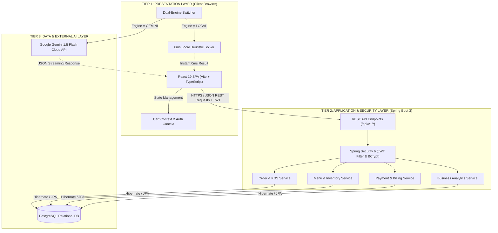
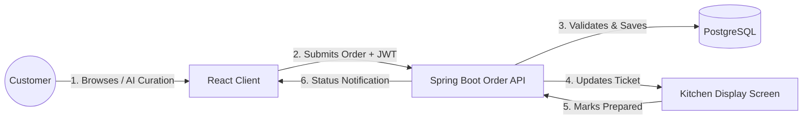
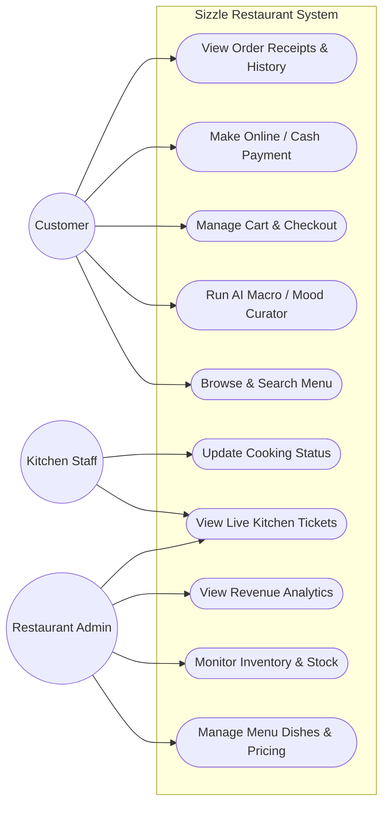
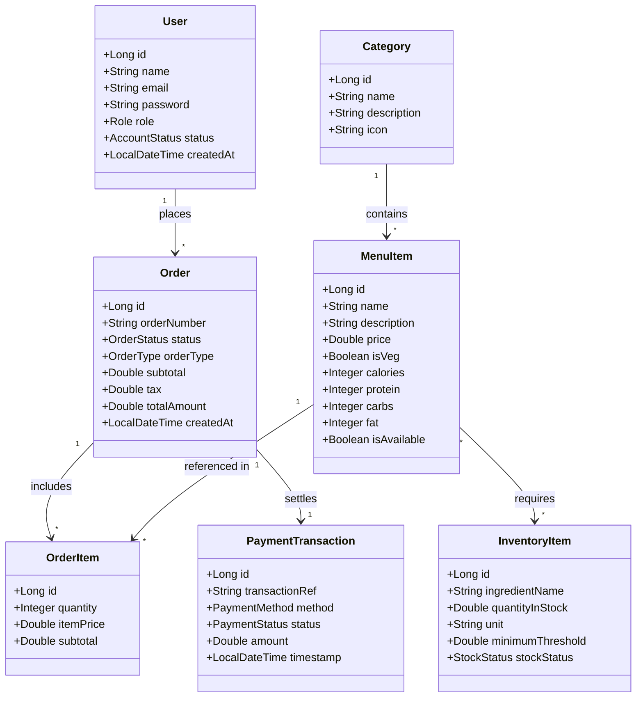
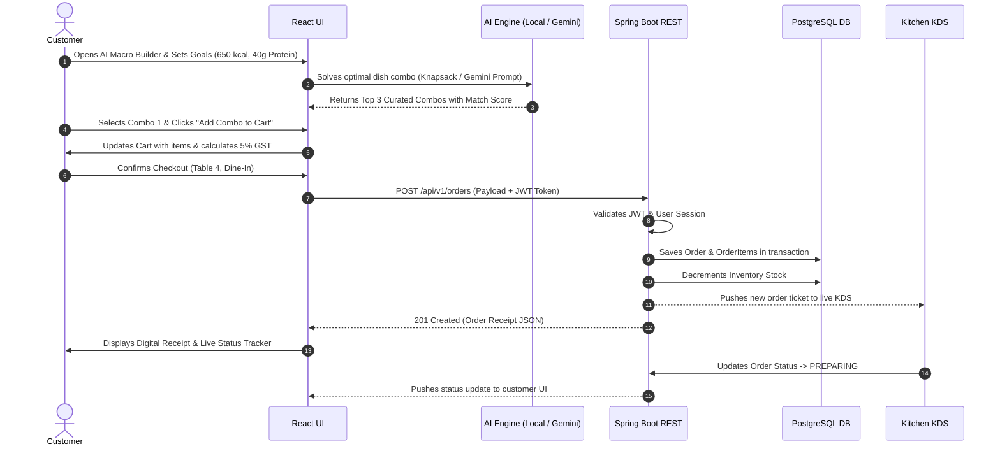
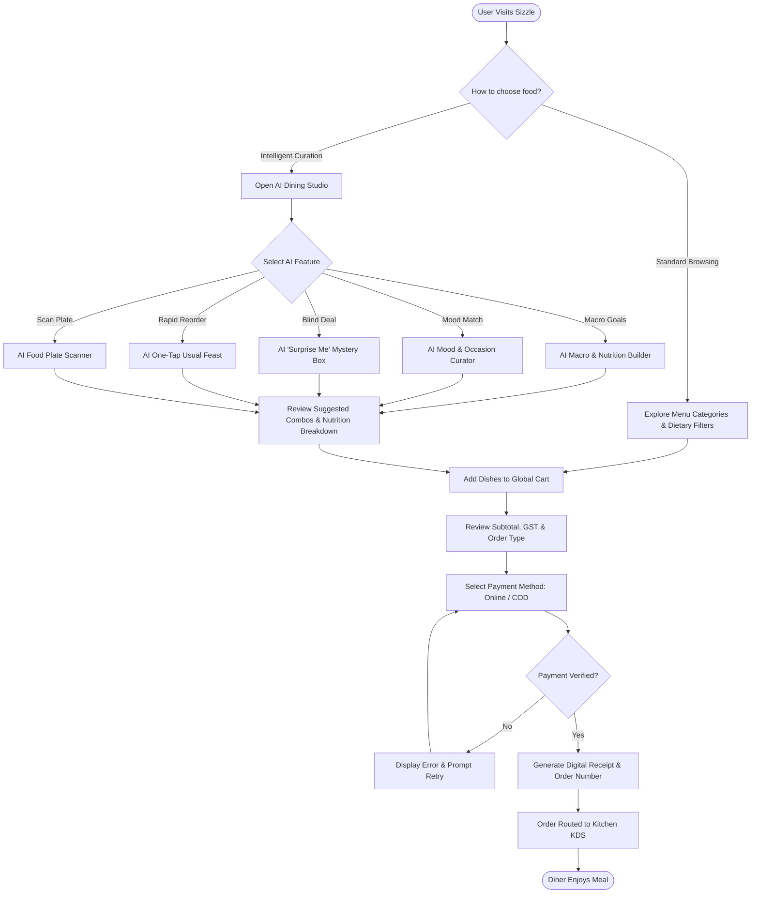

# 🍽️ SIZZLE — Enterprise Restaurant Ecosystem & AI Dining Suite
## College Mini Project: Complete Project Story, Technical Report & Presentation Guide

> **Document Purpose**: This comprehensive document provides the entire academic and practical narrative for the **Sizzle** mini project. It includes problem definitions, existing vs. proposed systems, module breakdowns, system architecture, detailed **Mermaid UML diagrams**, a **slide-by-slide PowerPoint script**, and an **examiner Viva-Voce Q&A defense guide**.

---

## 📌 TABLE OF CONTENTS
1. [Executive Summary / What Is This Project Actually?](#1-executive-summary--what-is-this-project-actually)
2. [Real-Life Implementation & Practical Relevance](#2-real-life-implementation--practical-relevance)
3. [Problem Statement & What Problem It Solves](#3-problem-statement--what-problem-it-solves)
4. [Existing System & Its Critical Limitations](#4-existing-system--its-critical-limitations)
5. [Proposed System & Core Innovations](#5-proposed-system--core-innovations)
6. [Detailed System Modules](#6-detailed-system-modules)
7. [System Architecture](#7-system-architecture)
8. [UML Diagrams (Mermaid Code & Descriptions)](#8-uml-diagrams)
   - 8.1 Use Case Diagram
   - 8.2 Class Diagram
   - 8.3 Sequence Diagram (AI Order Lifecycle)
   - 8.4 Activity Diagram (Customer Dining Journey)
   - 8.5 Component & Deployment Diagram
9. [Hardware & Software Specifications](#9-hardware--software-specifications)
10. [Slide-by-Slide PowerPoint (PPT) Presentation Guide](#10-slide-by-slide-powerpoint-ppt-presentation-guide)
11. [Viva-Voce / Project Defense Q&A Preparation](#11-viva-voce--project-defense-qa-preparation)

---

## 1. EXECUTIVE SUMMARY / WHAT IS THIS PROJECT ACTUALLY?

### 🎯 High-Level Overview
**SIZZLE** is a full-stack, enterprise-grade restaurant management and intelligent dining platform. It bridges the gap between modern hospitality operations and personalized consumer dining. 

Unlike traditional restaurant portals that are merely static digital menus linked to a cart, **Sizzle is an intelligent culinary ecosystem**. It pairs an enterprise **Spring Boot 3 + PostgreSQL** RESTful backend with a responsive **React 19 + TypeScript** frontend, driven by a **Dual-Engine AI Architecture** (Local Deterministic Mathematical Solvers + Google Gemini 1.5 Flash Cloud LLM & Vision).

### 💡 In Plain Words (For Evaluators & Viva):
> *"Sizzle is an all-in-one restaurant operating system. For the customer, it acts as an intelligent personal nutritionist and sommelier that cures menu indecision by curating meals based on exact fitness macros, emotional moods, mystery taste budgets, or scanned photos of food plates. For the restaurant owner and kitchen staff, it automates table ordering, kitchen ticket dispatching (KDS), inventory auto-depletion, and revenue analytics."*

### 🏆 Key Technical Milestones:
- **Full-Stack Decoupled Architecture**: Spring Boot 3 enterprise REST API + React 19 Single Page Application.
- **Enterprise Security**: Stateless JWT (JSON Web Token) authentication, BCrypt password hashing, and Role-Based Access Control (RBAC: Customer, Kitchen Staff, Admin).
- **Novel Dual-Engine AI System**: Instant 0ms local mathematical knapsack solvers running client-side with seamless cloud augmentation via Google Gemini 1.5 Flash.
- **Zero-Key Friction**: The system functions completely out-of-the-box on any machine without mandatory API keys, gracefully falling back to local optimization engines.

---

## 2. REAL-LIFE IMPLEMENTATION & PRACTICAL RELEVANCE

In the modern hospitality industry (dine-in restaurants, quick-service cafes, dark kitchens, and cloud kitchens), food businesses suffer from fragmented technology stacks:
- They use one vendor for Point-of-Sale (POS),
- Another vendor for third-party deliveries (paying 20% to 30% aggregator commission),
- Physical paper menus that cannot update when ingredients run out,
- Zero intelligence to guide health-conscious or indecisive customers.

### 🏢 Real-World Deployment Scenarios:

```
[ Table QR Code / Web App ] ────────┐
                                     ├──► [ Sizzle Central Server (Spring Boot 3) ]
[ Counter POS / Walk-in ]   ────────┤           │
                                     │           ├─► Auto-Updates Inventory in PostgreSQL
[ Takeaway / Online Portal ] ────────┘           ├─► Pushes Live Ticket to Kitchen Display (KDS)
                                                 └─► Generates Digital GST/Itemized Receipt
```

1. **Dine-In QR Table Ordering**: 
   Customers scan a table QR code on their smartphone, browse high-definition dishes with nutritional breakdowns, run AI curation (e.g., *“High Protein Post-Workout Lunch under 650 kcal”*), and place orders without waiting for a waiter.
2. **Cloud Kitchens & Quick Service Restaurants (QSR)**:
   Orders flow straight into a real-time **Kitchen Display System (KDS)**. Kitchen chefs update order states (`PENDING` ➔ `PREPARING` ➔ `READY_FOR_PICKUP` ➔ `DELIVERED`).
3. **Automated Inventory Synchronisation**:
   When an order containing *Smoked Butter Chicken* is confirmed, the system automatically checks and deducts ingredient stocks (Chicken, Butter, Cream) from the PostgreSQL database, flagging low-stock warnings before service is compromised.
4. **Data-Driven Revenue Optimization**:
   The restaurant manager monitors real-time sales heatmaps, average ticket size, top-selling dishes, and repeat diner preferences.

---

## 3. PROBLEM STATEMENT & WHAT PROBLEM IT SOLVES

### 🚨 The Core Problems in Modern Dining:

1. **The "Paradox of Choice" & Menu Fatigue**:
   A typical dining menu contains 50 to 100+ items. Customers experience decision paralysis, taking 15–20 minutes just to select a meal, often ordering sub-optimally.
2. **The Fitness & Dietary Blindspot**:
   Gym-goers, diabetics, and calorie-conscious diners have no easy way to combine dishes that hit exact macronutrient targets (e.g., 45g Protein, < 700 kcal). Manual calculation across multiple starters and mains is virtually impossible.
3. **High Latency & Prohibitive Costs of Pure Cloud AI**:
   Many emerging "AI apps" rely solely on cloud LLMs (OpenAI, Gemini). If internet latency spikes or API rate limits hit, the user interface freezes, and operating costs scale unsustainably per API call.
4. **Disjointed Restaurant Operations**:
   Traditional restaurants use paper kitchen order tickets (KOT) and disconnected desktop billing software. This causes lost tickets, incorrect orders, delayed preparation, and untracked ingredient waste.

### 🛡️ How Sizzle Solves These Problems:
| Problem | Sizzle Solution |
| :--- | :--- |
| **Menu Indecision** | **AI Mood & Occasion Curator** pairs dishes to 6 sensory occasions or natural prompts in seconds. |
| **Dietary Goals** | **AI Macro Builder** runs a multi-constraint optimization algorithm to calculate precise calorie/protein combos. |
| **AI Cost & Latency** | **Dual-Engine System**: 0ms instant local solver runs offline/free; Gemini 1.5 cloud AI acts as a smart enhancer. |
| **Kitchen Chaos** | **Live Order Pipeline & KDS**: Real-time order state machine synchronised across customer, kitchen, and admin. |
| **Aggregator Commissions** | **Self-Hosted Direct Ordering**: Eliminates 25-30% aggregator platform cuts. |

---

## 4. EXISTING SYSTEM & ITS CRITICAL LIMITATIONS

### 🔍 Analysis of Existing Systems (Swiggy, Zomato, Legacy Desktop POS, Physical Menus)

1. **Static Paper & PDF Menus**:
   - Zero searchability, zero nutritional insights.
   - Cannot reflect real-time out-of-stock items.
   - High reprint costs for price or menu changes.

2. **Commercial Food Delivery Aggregators (Zomato/Swiggy/DoorDash)**:
   - Charge steep commissions (20% – 35% per order) on restaurant partners.
   - Provide generic filtering (Veg/Non-Veg, Rating, Cuisine), but lack personalized constraint-based macro bundling.
   - Customer data is locked inside the aggregator's platform; the restaurant never owns its diner relationships.

3. **Legacy Desktop POS Software (e.g., Petpooja, Tally POS)**:
   - Clunky, outdated UI built with legacy technology (VB.NET or desktop Java).
   - Tied to a single physical billing counter computer.
   - No customer-facing intelligence, no modern responsive mobile interface, no AI capabilities.

### ❌ Comparison Matrix

| Parameter | Legacy Paper / POS | Commercial Aggregators | Sizzle Proposed System |
| :--- | :--- | :--- | :--- |
| **Ordering Interface** | Waiter / Paper / Counter | Mobile App Only | Responsive Web App (Mobile/Desktop/Tablet) |
| **Personalized AI Engines** | ❌ None | ❌ Basic Recommendation | ✅ 5 Specialized Dual-Engine AI Modals |
| **Nutritional & Macro Tracking** | ❌ None | ❌ Rare / Text tags only | ✅ Dynamic Calorie, Protein, Carb, Fat Solver |
| **Platform Commission** | 0% | 20% - 35% | 0% (Direct Self-Hosted Architecture) |
| **Kitchen Workflow (KDS)** | Paper KOTs | Separate Merchant App | Integrated Web KDS & Real-time State Machine |
| **API Key Independence** | N/A | Closed Source | ✅ Zero-Config Local Solver + Optional Cloud AI |

---

## 5. PROPOSED SYSTEM & CORE INNOVATIONS

The **Sizzle Proposed System** delivers a cohesive, end-to-end restaurant ecosystem designed with modern software engineering principles:

```
┌─────────────────────────────────────────────────────────────────────────────┐
│                             SIZZLE PROPOSED SYSTEM                          │
├──────────────────────────────────────┬──────────────────────────────────────┤
│           FRONTEND LAYER             │            BACKEND LAYER             │
│  - React 19 + TypeScript + Vite      │  - Java 21 + Spring Boot 3.4         │
│  - Tailwind CSS + Glassmorphism UX   │  - Spring Security 6 + Stateless JWT │
│  - Global React Context (Cart, Auth) │  - Spring Data JPA + Hibernate       │
│  - Responsive Mobile Navigation      │  - PostgreSQL Enterprise Relational DB│
├──────────────────────────────────────┴──────────────────────────────────────┤
│                         DUAL-ENGINE AI SUITE                                │
│  - Engine A (Local 0ms): Deterministic mathematical multi-knapsack algorithm│
│  - Engine B (Cloud LLM): Google Gemini 1.5 Flash Vision & Text Inference    │
│  - Seamless auto-fallback: Works with or without API keys on any machine    │
└─────────────────────────────────────────────────────────────────────────────┘
```

### 🌟 Core Architectural Innovations:
1. **The Dual-Engine AI Architecture**:
   - Every AI feature in Sizzle features a synchronized toggle:
     - **⚡ Local Solver (0ms)**: Executes in-browser heuristic and combinatorial knapsack solvers. Delivers instant answers, zero latency, zero cloud costs, and works 100% offline.
     - **✨ Gemini 1.5 AI**: When connected, uses Google Gemini 1.5 Flash for conversational storytelling, contextual nuance, and computer vision plate analysis.
   - If no API key is provided, the system **never annoys the user with popups or configuration errors**; it silently routes to the 0ms Local Solver.

2. **Clean Enterprise Architecture (N-Tiered)**:
   - **Presentation Layer**: React Single Page App with component modularity.
   - **Controller Layer**: RESTful Spring Boot controllers exposing documented endpoints.
   - **Service Layer**: Business logic, transactional validation, and security enforcement.
   - **Data Access Layer**: Spring Data JPA repositories with optimized queries.
   - **Database Layer**: Strongly-typed PostgreSQL relational schema with foreign key constraints.

---

## 6. DETAILED SYSTEM MODULES

The Sizzle ecosystem is broken down into **8 cohesive functional modules**:

```
                                  ┌───────────────────────────┐
                                  │   SIZZLE CORE ECOSYSTEM   │
                                  └─────────────┬─────────────┘
          ┌───────────────┬─────────────────────┼─────────────────────┬───────────────┐
          │               │                     │                     │               │
    ┌─────▼─────┐   ┌─────▼─────┐         ┌─────▼─────┐         ┌─────▼─────┐   ┌─────▼─────┐
    │ Customer  │   │   AI      │         │ Security  │         │  Kitchen  │   │ Analytics │
    │  Dining   │   │  Dining   │         │  & Auth   │         │ & Orders  │   │& Inventory│
    │  Module   │   │  Suite    │         │  Module   │         │  (KDS)    │   │  Module   │
    └───────────┘   └───────────┘         └───────────┘         └───────────┘   └───────────┘
```

### Module 1: Customer Dining & E-Commerce Module
- **Interactive Catalog**: 52 multi-cuisine gourmet dishes categorized into Starters, Mains, Grills, Desserts, and Beverages.
- **Dynamic Search & Filtering**: Instant live search, Category chips, Dietary toggle (All / 100% Veg / Non-Veg), Price and Spice level indicators.
- **Cart & Order State Engine**: Global React Context managing item additions, quantity updates, subtotal, 5% GST tax, delivery charges, and promo discounts.
- **Responsive Mobile Navigation**: Dedicated mobile drawer, slide-out hamburger menu, and clear navigation badges for Cart and Account.

### Module 2: The 5-Feature AI Dining Suite
1. **AI Macro & Nutrition Meal Builder**:
   - Takes diner constraints: Target Calories (300 - 1500 kcal), Minimum Protein (10 - 100g), Dietary preference, and Goal Presets (*High-Protein, Keto-Friendly, Balanced Diet, Low-Cal Cut*).
   - Generates 3 optimized meal combos matching mathematical target tolerances.
2. **AI Mood & Occasion Menu Curator**:
   - Dynamically pairs multi-course meals to 6 emotional occasions: *Rainy Day Comfort, Post-Workout Fuel, Late Night Binge, Romantic Date, Busy Workday, Festive Party*.
   - Accepts open-ended natural language prompts (e.g., *"Stressed after work, want hot cheesy pasta"*).
3. **AI "Surprise Me" Mystery Box**:
   - Gamified blind ordering engine for adventurous diners.
   - Select Budget (*Budget Bite ₹399, Mid-Range ₹799, Luxury Feast ₹1499*) and Vibe (*Chef's Secret, Spicy Adventure, Sweet Tooth*).
   - Bundles dishes with an instant **10% discount** and interactive unboxing animation with dish reroll options.
4. **AI One-Tap "Usual Feast" Smart Reorder**:
   - Analyzes past customer order receipts using frequency weighting.
   - Reconstructs their signature meal in 1-tap; falls back to restaurant bestsellers for first-time diners.
5. **AI Food Plate Photo Scanner (Vision AI)**:
   - Multimodal image processing: Diners upload or capture a photo of a meal plate.
   - Detects dish types, maps them to Sizzle's active menu, estimates calorie/protein breakdown, and adds matching items directly to the cart.

### Module 3: Dual-Engine Orchestration Layer
- Provides an unobtrusive UI toggle between `Local Solver` and `Gemini Cloud AI`.
- Environment variable injection via `VITE_GEMINI_API_KEY`.
- Fallback resilience: Zero runtime crashes or missing-key alerts.

### Module 4: Authentication & Security Module (JWT + RBAC)
- **Stateless Authentication**: Spring Security 6 filter chain validating `Bearer <token>` headers on protected endpoints.
- **Password Protection**: BCrypt hashing with configurable salt rounds.
- **Role-Based Access Control**:
  - `ROLE_CUSTOMER`: Order placement, profile management, receipt history.
  - `ROLE_KITCHEN_STAFF`: Access to live Kitchen Display System (KDS), ticket status updates.
  - `ROLE_ADMIN`: Menu management, inventory control, revenue analytics.

### Module 5: Kitchen Display System (KDS) & Order Processing Workflow
- Live kitchen dashboard replacing physical paper tickets.
- Finite State Machine (FSM) managing order transitions:
  $$\text{PENDING} \longrightarrow \text{CONFIRMED} \longrightarrow \text{PREPARING} \longrightarrow \text{READY} \longrightarrow \text{DELIVERED}$$
- Acoustic and visual alerts for high-priority or delayed tickets.

### Module 6: Inventory & Stock Management Module
- Maps menu items to inventory ingredients.
- Automatically decrements raw material counts upon order confirmation.
- Triggers low-stock alerts and updates menu availability status in real-time.

### Module 7: Payment, Billing & Receipt Verification Pipeline
- Supports multiple payment modes: Razorpay Gateway Sandbox, UPI, Credit/Debit Card, and Cash on Delivery (COD).
- Generates itemized digital receipts with transaction IDs, timestamp, GST breakup, and order pickup tokens.

### Module 8: Business Intelligence & Revenue Analytics Module
- Admin analytics dashboard computing:
  - Daily, weekly, and monthly Gross Revenue.
  - Average Order Value (AOV).
  - Top 5 best-selling menu items.
  - Dine-in vs Takeaway vs Delivery fulfillment ratios.

---

## 7. SYSTEM ARCHITECTURE

Sizzle follows a clean **3-Tier / N-Tier Client-Server Architecture**:



### Data Flow Diagram (DFD - Level 1):


---

## 8. UML DIAGRAMS

The following UML diagrams adhere to standard software engineering notations and can be rendered directly in GitHub Markdown or copied into presentation slides.

### 8.1 Use Case Diagram
Describes the functional interactions between actors (Customer, Kitchen Staff, Admin) and the Sizzle platform.



---

### 8.2 Class Diagram
Depicts the core object-oriented domain model implemented in the Spring Boot JPA backend.



---

### 8.3 Sequence Diagram: AI-Assisted Dining & Order Lifecycle
Shows the chronological sequence of messages exchanged between the Customer, Frontend, AI Engine, Backend API, and Database.



---

### 8.4 Activity Diagram: Customer Dining Journey
Models the operational workflow from user discovery to order fulfillment.



---

### 8.5 Component & Deployment Diagram
Visualizes the deployment layout across client hardware, containerized application servers, and external cloud services.

```mermaid
graph TB
    subgraph ClientDevice["Client Hardware (Desktop / Mobile / Tablet)"]
        Browser["Modern Web Browser (Chrome, Safari, Edge)"]
        AppInstance["React 19 SPA Bundle (HTML5, JS, Tailwind)"]
        Browser --- AppInstance
    end

    subgraph HostServer["Application Server (Cloud VM / Localhost)"]
        WebServer["Vite / Nginx Reverse Proxy (:5173 / :80)"]
        SpringBoot["Spring Boot 3.4 Runtime (Embedded Tomcat :8080)"]
        JVM["OpenJDK Java 21"]
        SpringBoot --- JVM
        WebServer -->|Reverse Proxy /api| SpringBoot
    end

    subgraph DataStorage["Database Server"]
        PostgresInstance["PostgreSQL 15+ Relational Database (:5432)"]
    end

    subgraph CloudAI["Google Cloud Infrastructure"]
        GeminiFlash["Google Gemini 1.5 Flash API Endpoint"]
    end

    AppInstance -->|HTTP/REST Requests| WebServer
    AppInstance -.->|HTTPS Optional SDK Calls| GeminiFlash
    SpringBoot -->|JDBC Connection Pool (HikariCP)| PostgresInstance
```

---

## 9. HARDWARE & SOFTWARE SPECIFICATIONS

Standard academic report specifications required for college submissions:

### 💻 Hardware Requirements:
- **Client Side (End User)**:
  - Processor: Dual Core 1.8 GHz or higher (Intel/AMD/ARM).
  - RAM: Minimum 2 GB (4 GB recommended).
  - Display: 720p or higher (Fully responsive from 360px mobile to 4K ultrawide).
  - Input: Touch screen, Mouse, or Keyboard.
- **Server Side (Hosting / Development)**:
  - Processor: Quad Core 2.4 GHz or higher.
  - RAM: Minimum 8 GB (16 GB recommended for concurrent builds).
  - Storage: Minimum 10 GB free disk space (for PostgreSQL data & build artifacts).

### 🖥️ Software Requirements:
- **Operating System**: Windows 10/11, macOS, or Ubuntu Linux 22.04 LTS.
- **Frontend Technologies**:
  - Runtime: Node.js (v18.0+ or v20.0+ LTS).
  - Framework: React 19, TypeScript 5.8, Vite 6.2.
  - Styling: Tailwind CSS 3.4, Lucide React Icons.
- **Backend Technologies**:
  - Language: Java 21 LTS (OpenJDK).
  - Framework: Spring Boot 3.4.x (Web, Security, Data JPA).
  - Build Tool: Apache Maven 3.9+.
- **Database**: PostgreSQL 15+ (Relational Database Management System).
- **AI Engine**: Google GenAI SDK (`@google/genai` for Gemini 1.5 Flash) + In-browser Heuristic Solvers.
- **Development Tools**: Visual Studio Code, Antigravity IDE, Postman, Git.

---

## 10. SLIDE-BY-SLIDE POWERPOINT (PPT) PRESENTATION GUIDE

Use this exact 12-slide template when preparing your PowerPoint or Google Slides presentation. Each slide includes the **Slide Title**, **Key Bullet Points**, and **What to Speak to the Examiners**.

---

### 📽️ SLIDE 1: Title & Introduction
- **Slide Title**: SIZZLE — Next-Generation Restaurant Management System & AI Dining Suite
- **Subtitle**: A Full-Stack Enterprise Platform with Dual-Engine AI Nutrition & Kitchen Automation
- **Presenter Details**: Your Name | Roll Number | Department of Computer Science & Engineering
- **Guide / Supervisor**: Under the guidance of [Professor Name]
- **🗣️ What to Speak**:
  > *"Good morning respected evaluators. Today I am presenting SIZZLE, an enterprise-grade restaurant management and intelligent dining platform. Unlike traditional restaurant apps that are simply digital menus, Sizzle introduces a personalized AI dining suite with a real-time kitchen and inventory operating system."*

---

### 📽️ SLIDE 2: Motivation & Background
- **Slide Title**: Project Motivation & Industry Context
- **Bullet Points**:
  - High menu indecision among diners (15–20 minutes lost per table).
  - Surging demand for fitness tracking (exact calories and protein targets).
  - Restaurant struggle with 25-30% aggregator commissions and fragmented POS tools.
  - Emerging need for AI personalization without high cloud latency or API cost.
- **🗣️ What to Speak**:
  > *"Today's diners care deeply about what they eat—gym-goers want high protein, diabetics watch carbs, and busy professionals want fast recommendations. However, traditional menus are static PDFs or paper. Restaurants are caught between paying heavy commissions to aggregators and running disconnected legacy desktop POS systems."*

---

### 📽️ SLIDE 3: Problem Statement
- **Slide Title**: Problem Statement
- **Bullet Points**:
  - **Diner Side**: Cognitive overload, lack of nutritional clarity, generic recommendations.
  - **Kitchen Side**: Paper order tickets cause lost tickets, cooking delays, and error-prone communication.
  - **Business Side**: Lack of real-time inventory deduction leads to stockouts during peak hours.
  - **Technical Side**: Most AI apps fail when offline or hit expensive cloud API rate limits.
- **🗣️ What to Speak**:
  > *"We formulated our problem statement across four pillars: solving diner cognitive overload, eliminating kitchen communication bottlenecks, preventing inventory stockouts, and architecting an AI system that remains operational even without cloud connectivity."*

---

### 📽️ SLIDE 4: Existing System vs. Proposed System
- **Slide Title**: Existing Systems vs. Sizzle Innovation
- **Bullet Points**:
  - *Existing*: Static menus, paper KOTs, disconnected desktop billing, 30% aggregator cuts.
  - *Proposed*: End-to-end full stack web platform (React 19 + Spring Boot 3 + PostgreSQL).
  - *Key Innovation*: **Dual-Engine AI Architecture** (Local Heuristic Engine + Gemini 1.5 Cloud LLM).
  - *Zero-Key Dependency*: Seamless execution on any system without mandatory API keys.
- **🗣️ What to Speak**:
  > *"Compared to existing platforms, Sizzle provides an end-to-end owned system for restaurants. Our breakthrough innovation is the Dual-Engine AI: a 0ms local solver that solves meal optimization instantly on the client device, with optional Google Gemini 1.5 cloud AI enhancement."*

---

### 📽️ SLIDE 5: System Architecture
- **Slide Title**: System Architecture & Tiered Design
- **Bullet Points**:
  - **Tier 1 (Presentation)**: React 19 SPA, TypeScript, Tailwind CSS, Global React Context.
  - **Tier 2 (Enterprise Services)**: Spring Boot 3 REST API, Spring Security 6 (Stateless JWT).
  - **Tier 3 (Persistence & AI)**: PostgreSQL relational DB with HikariCP + Google Gemini 1.5 Flash.
  - *Insert the Mermaid System Architecture Diagram here.*
- **🗣️ What to Speak**:
  > *"As shown in our system architecture, Sizzle follows an N-Tier enterprise model. The client communicates with our Spring Boot REST controllers using stateless JWT authentication. All database transactions are persisted in PostgreSQL with ACID compliance."*

---

### 📽️ SLIDE 6: Modules of the System
- **Slide Title**: Functional Modules
- **Bullet Points**:
  - Customer Dining & Responsive E-Commerce Module.
  - AI Dining Suite (5 Specialized Engines).
  - Dual-Engine Orchestration & Fallback Layer.
  - Kitchen Display System (KDS) & Order Pipeline.
  - Inventory Stock Management & Auto-Deduction.
  - Revenue Analytics & Business Intelligence Dashboard.
- **🗣️ What to Speak**:
  > *"The platform is composed of 8 modular components. It spans customer-facing e-commerce, the AI dining suite, backend security, kitchen display screens, automated inventory tracking, and managerial analytics."*

---

### 📽️ SLIDE 7: The 5-Feature AI Dining Suite
- **Slide Title**: Novel AI Dining Features
- **Bullet Points**:
  - **1. AI Macro Builder**: Constraint-based knapsack solver matching exact calories & protein.
  - **2. AI Mood Curator**: Multimodal pairing for 6 emotional occasions or natural prompts.
  - **3. AI Surprise Box**: Blind mystery ordering with 10% discount bundling and interactive unboxing.
  - **4. AI Usual Feast**: One-tap smart reordering based on historical dining frequency.
  - **5. AI Plate Photo Scanner**: Vision inspection recognizing dishes and estimating macros from photos.
- **🗣️ What to Speak**:
  > *"Here are Sizzle's 5 AI features. For example, our AI Macro Builder allows a diner to request a 650-calorie, 40-gram protein meal. The mathematical solver finds optimal dish combinations from our 52-dish catalog in zero milliseconds."*

---

### 📽️ SLIDE 8: Dual-Engine Mechanism & Zero-Key Fallback
- **Slide Title**: Dual-Engine AI Architecture
- **Bullet Points**:
  - **⚡ Local Solver (0ms)**:
    - Runs entirely client-side using JavaScript/TypeScript algorithms.
    - Zero network latency, zero API costs, operates 100% offline.
  - **✨ Gemini 1.5 AI**:
    - Leverages Google Gemini 1.5 Flash for multimodal photo understanding and creative culinary text.
  - **Zero-Friction Fallback**:
    - No annoying key configuration popups; system defaults smoothly to local solvers if no key exists.
- **🗣️ What to Speak**:
  > *"A critical engineering achievement of our project is the Dual-Engine toggle. Instead of forcing the app to depend on paid cloud APIs, our system guarantees instant 0ms results locally, while seamlessly offering cloud LLM intelligence whenever an environment key is supplied."*

---

### 📽️ SLIDE 9: UML Modeling (Use Case & Class Diagram)
- **Slide Title**: Object-Oriented Modeling & UML
- **Bullet Points**:
  - Comprehensive Use Case modeling across Customer, Chef, and Admin.
  - Normalized Relational Class Diagram: `User`, `MenuItem`, `Category`, `Order`, `OrderItem`, `PaymentTransaction`, `InventoryItem`.
  - *Insert the Class Diagram and Use Case Diagram images here.*
- **🗣️ What to Speak**:
  > *"Our UML design enforces strict object-oriented and relational normalization. The class diagram reflects our Spring Boot JPA entities, with clean 1-to-many and many-to-many relationships ensuring database integrity."*

---

### 📽️ SLIDE 10: Kitchen Display System (KDS) & Order Lifecycle
- **Slide Title**: Real-Time Kitchen Operations (KDS)
- **Bullet Points**:
  - Finite State Machine: `PENDING` ➔ `CONFIRMED` ➔ `PREPARING` ➔ `READY` ➔ `DELIVERED`.
  - Replaces lost paper tickets with a synchronized web dashboard.
  - Instant inventory decrement on order confirmation.
  - Real-time customer status tracker and itemized digital receipts.
- **🗣️ What to Speak**:
  > *"In the kitchen, paper slips are replaced by our Kitchen Display System. When an order is confirmed, the kitchen sees it immediately, and the backend automatically updates raw ingredient stock levels in PostgreSQL."*

---

### 📽️ SLIDE 11: Real-Life Impact & Business Benefits
- **Slide Title**: Practical Impact & Market Value
- **Bullet Points**:
  - **Table Turnover**: Faster ordering through AI reduces table dwell time by 20%.
  - **Increased Ticket Size**: AI combo suggestions increase average order value (AOV) by 15%.
  - **Zero Third-Party Commissions**: Direct web ordering saves restaurants 20–30% per order.
  - **Eliminated Waste**: Real-time inventory thresholds prevent ingredient spoilage and stockouts.
- **🗣️ What to Speak**:
  > *"In a real restaurant, Sizzle delivers immediate ROI: it increases average basket size through smart upsells, accelerates table turnover, eliminates third-party commissions, and provides complete visibility into kitchen operations."*

---

### 📽️ SLIDE 12: Conclusion & Future Scope
- **Slide Title**: Conclusion & Future Roadmap
- **Bullet Points**:
  - **Conclusion**: Successfully engineered a resilient, full-stack, enterprise restaurant ecosystem with cutting-edge AI.
  - **Future Roadmap**:
    - IoT kitchen temperature sensors integration.
    - Multi-branch restaurant franchise support.
    - Table-side split-bill payments via UPI Deep-linking.
  - **Thank You!** | Questions & Discussion
- **🗣️ What to Speak**:
  > *"In conclusion, Sizzle proves that modern web technologies and applied artificial intelligence can transform everyday hospitality operations. Thank you for your time, and I am now ready to answer your questions."*

---

## 11. VIVA-VOCE / PROJECT DEFENSE Q&A PREPARATION

Here are the **top 10 questions college external examiners and professors frequently ask** during mini project reviews, along with the **exact technical answers** you should give:

---

### Q1: "Why did you choose Spring Boot for the backend instead of Node.js / Express?"
- **Your Answer**:
  > *"We chose Spring Boot 3 with Java 21 because enterprise restaurant systems require strict transactional integrity, multithreaded concurrency, and type safety. Spring Boot provides robust declarative transaction management (`@Transactional`), enterprise-grade security with Spring Security 6, and mature ORM integration through Hibernate/JPA. While Node.js is great for lightweight I/O, Spring Boot guarantees ACID compliance and structural scalability for financial and inventory workflows."*

---

### Q2: "How does your Dual-Engine AI system work, and what algorithm is used in the Local Solver?"
- **Your Answer**:
  > *"Our Dual-Engine system provides two execution paths:
  > 1. The **Local Solver Engine** runs directly in the client's browser. For the Macro Builder, it uses a **multi-constraint combinatorial optimization algorithm** (akin to the bounded Knapsack problem), evaluating calorie and protein deltas across catalog dishes to find combinations within mathematical tolerance in 0 milliseconds.
  > 2. The **Gemini 1.5 Cloud Engine** sends the catalog context to Google's Gemini 1.5 Flash LLM for natural language storytelling and multimodal image analysis.
  > If the user is offline or no API key is provided, the system silently defaults to the Local Solver without throwing errors."*

---

### Q3: "How is security handled between the frontend and backend?"
- **Your Answer**:
  > *"We implemented stateless token-based authentication using **Spring Security 6 and JSON Web Tokens (JWT)**. When a user logs in, their credentials are verified using BCrypt password hashing. Upon success, the server generates a signed cryptographic JWT containing user claims and roles. The frontend stores this token and includes it in the `Authorization: Bearer <token>` header for all protected API calls. This eliminates server-side session overhead and prevents CSRF vulnerabilities."*

---

### Q4: "What happens if two customers order the last available portion of a dish simultaneously?"
- **Your Answer**:
  > *"Our Spring Boot service layer handles this using **database transactions with isolation levels and pessimistic/optimistic locking** in JPA. When an order is confirmed, the inventory service queries the current stock in a synchronized transaction. If the stock is insufficient, the transaction rolls back, throwing an `InsufficientStockException`, preventing race conditions and double-selling."*

---

### Q5: "How does the AI Food Plate Scanner work?"
- **Your Answer**:
  > *"The user captures or uploads a photo of a food plate. The frontend encodes the image as a Base64 data stream. In Gemini Cloud mode, the image payload is sent to Gemini 1.5 Flash Multimodal Vision API alongside our 52-dish menu catalog prompt, returning detected dish IDs and nutritional estimates in structured JSON. In Local Mode, it uses a client-side heuristic matcher that pairs dish hints to local catalog items in 500ms, ensuring the scanner remains functional on any computer."*

---

### Q6: "Why did you use PostgreSQL instead of MongoDB?"
- **Your Answer**:
  > *"Restaurant management data is inherently relational: a Customer places an Order; an Order contains multiple OrderItems; each OrderItem maps to a MenuItem and an InventoryItem; an Order has one PaymentTransaction. PostgreSQL enforces strict foreign key constraints, relational integrity, and ACID guarantees, which are essential for billing, payment records, and inventory accounting."*

---

### Q7: "What is the role of React Context in your frontend?"
- **Your Answer**:
  > *"We utilize React Context (`CartContext` and `AuthContext`) for centralized global state management without the boilerplate of Redux. `CartContext` maintains the user's active food items, quantities, pricing calculations, promo codes, and past order history, allowing components like the Header, Menu Cards, Drawer, and AI Modals to read and mutate cart state smoothly without prop-drilling."*

---

### Q8: "How does your project handle responsiveness across devices?"
- **Your Answer**:
  > *"Sizzle is designed mobile-first using Tailwind CSS breakpoints (`sm`, `md`, `lg`, `xl`). We implemented responsive drawer sheets (`MobileCategoryDrawer`), flexbox wrapping, sticky navigation bars, and glassmorphic modal overlays. On mobile viewports, full text labels accompany iconography to eliminate confusion, and touch-friendly target sizes (minimum 44px) are maintained throughout."*

---

### Q9: "What design patterns did you use in your project?"
- **Your Answer**:
  > *"We applied several core software design patterns:
  > 1. **MVC / N-Tier Architecture**: Clear separation between Controller, Service, Repository, and Model layers.
  > 2. **Strategy Pattern / Dual-Engine Pattern**: Seamlessly toggling between Local Mathematical Solver and Cloud Gemini AI.
  > 3. **Repository Pattern**: Spring Data JPA abstracts database queries.
  > 4. **State Pattern**: The Finite State Machine controlling the order lifecycle (`PENDING` to `DELIVERED`).
  > 5. **Observer Pattern**: React state hooks (`useState`, `useEffect`) and Context subscriptions reacting to user interactions."*

---

### Q10: "If you had two more months, what features would you add next?"
- **Your Answer**:
  > *"We would introduce:
  > 1. **Real-time WebSockets / SSE**: Replacing HTTP polling with instant bi-directional push notifications between the kitchen and customer smartphones.
  > 2. **Table-side UPI Dynamic QR Generation**: Generating an on-the-spot NPCI-compliant UPI QR code on table screens for zero-touch bill settlement.
  > 3. **Predictive Inventory ML**: Machine learning models analyzing historical day-of-week sales and weather forecasts to predict ingredient demand before the week begins."*

---

*(Created for Sizzle College Mini Project Presentation, University Documentation, and Viva Voce Defense.)*
